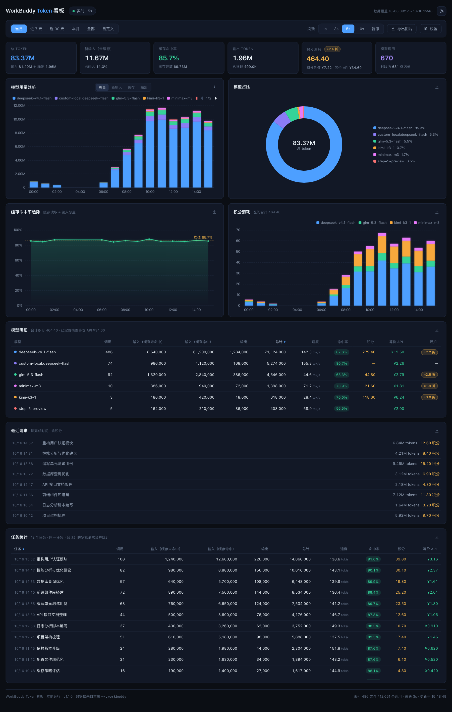
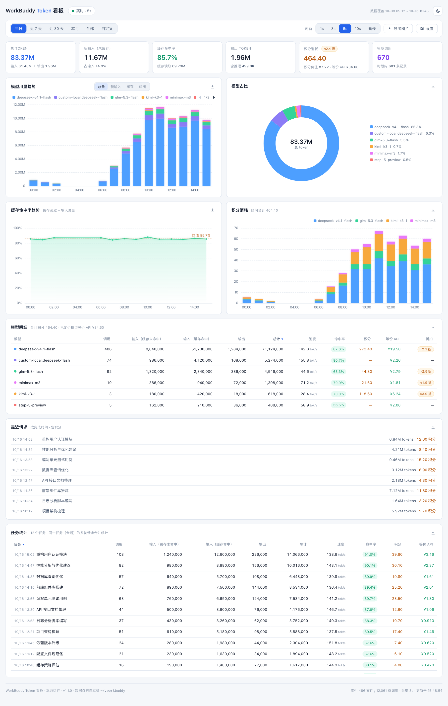

# WorkBuddy Token Dashboard

本地实时看板：可视化 **WorkBuddy** 的模型调用 token 消耗、积分使用与缓存命中率。

纯本地运行 · 零第三方依赖（仅 Python 标准库）· 只读数据、不上传任何内容。

> A local dashboard that visualizes WorkBuddy token usage, credit consumption and cache hit rate.
> Fully offline, zero dependencies, runs on macOS / Windows / Linux.



*（截图为演示数据）*

<details>
<summary>浅色主题</summary>



</details>

## 功能

- **按模型分类的图表**：用量趋势（可切换总量 / 新输入 / 缓存 / 输出四种指标）、占比环形图、明细表（调用数、缓存命中率、生成速度、积分、等价 API 价、折扣，支持点击表头排序，默认按总计降序）
- **设置面板**：顶栏「设置」按钮集中管理看板配置——积分套餐（金额 / 积分数，决定积分价值与折扣率折算）
  与任意模型的单价、显示颜色（可为官方未定价的模型补录价格）。保存后即时生效并持久化；每个模型可单独「恢复默认」
- **任务统计**：按连续任务（会话）聚合的明细表，列口径与模型明细一致；同一任务的多轮请求与跨模型调用合并统计，不拆分。仅统计有真实会话归属的任务，AI 自动审批等系统调用与无法命名归属的会话不参与
- **时间范围**：当日 / 近 7 天 / 近 30 天 / 本月 / 全部 / 自定义区间，分桶粒度随范围自动适配（5 分钟 ~ 月）
- **积分使用量**：区间合计、按时间分桶（按模型堆叠）、最近请求流水（带会话标题）
- **缓存命中率**：区间总体值与按时间分桶趋势线（含均值参考线）
- **积分价值与等价 API 价**：总览把积分按套餐价（默认 140 元 / 9000 积分）折算为「积分价值」，
  与按各厂商官方定价把 token 折算成的「等价 API 价」并列对照；积分卡片徽标显示两者比值（折扣，区间口径）
- **导出图片**：每个模块右上角可单独导出该模块为 PNG；顶部「导出图片」一键导出整个看板长图
  （含时间范围与导出时间标注）。导出内容始终与当前选择的时间线一致，滚动中的表格会展开为完整数据
- **实时刷新**：1s / 3s / 5s / 10s / 暂停可调；数据无变化时不重绘图表；
  页面切到后台自动降为 30s 低频轮询、回到前台立即恢复（服务端聚合结果按需缓存，重复请求毫秒级返回）；
  连接失败按指数退避自动重试（2s ~ 30s 封顶），恢复后立即回到所选频率
- **深色 / 浅色主题**，切换后本地记忆；响应式布局，窄屏自动单列
- **本地持久归档**：扫描到的数据写入本地 SQLite（`data/archive.db`，只增不删），
  即使 WorkBuddy 原始记录被轮转清理，历史统计也不会丢失

## 安装与运行

**环境要求**：Python 3.11+。无任何 pip 依赖。
若本机已安装 WorkBuddy，其自带的 Python 会被自动使用，无需额外安装。

**数据目录定位（Windows 用户请注意）**：默认读取 `~/.workbuddy`（Windows 即
`%USERPROFILE%\.workbuddy`，为 WorkBuddy 的主数据目录）。Windows 下若同时存在 agent 级目录
`%PROGRAMDATA%\WorkBuddy\users\<用户名>\.workbuddy`，程序会自动比较两者、选择**最近有活动**的一个；
也可用环境变量 `WORKBUDDY_HOME` 手动指定数据目录，例如：

```bash
WORKBUDDY_HOME="D:\path\to\.workbuddy" python server.py   # Windows PowerShell: $env:WORKBUDDY_HOME="..."
```

**macOS / Linux**

```bash
chmod +x start.sh
./start.sh           # 启动
./start.sh restart   # 重启（修改后端代码后重新加载）
./start.sh stop      # 停止
```

**Windows**

```bat
start.bat            :: 启动（服务在最小化的命令行窗口中运行）
start.bat restart    :: 重启（修改后端代码后重新加载）
start.bat stop       :: 停止
```

也可直接双击 `start.bat` 启动；关闭服务窗口同样可停止服务。

**手动运行（任意平台）**

```bash
python3 server.py
# 浏览器打开 http://127.0.0.1:8899
```

常见问题：

- 启动失败：查看同目录 `server.log`
- 端口被占用：修改 `server.py` 顶部 `PORT`（同时改启动脚本中的端口）
- 停止服务：macOS/Linux 执行 `./start.sh stop`；Windows 执行 `start.bat stop`（或关闭服务窗口）
- 修改后端代码后：执行 `./start.sh restart`（Windows 用 `start.bat restart`）重新加载（Python 进程不会热更新已加载的代码）
- 页面没有数据：属正常——看板读取的是**本机** `~/.workbuddy/` 的使用记录

## 数据来源

| 数据 | 来源 | 服务端采集节奏 |
|---|---|---|
| token 明细（模型、输入、输出、缓存命中） | `~/.workbuddy/traces/<pid>/trace_*.json` 与 `trace_*.jsonl`（新旧两种格式，均支持） | 增量扫描（随刷新设置 0.6–5 秒） |
| 调用上报（补充源） | `~/.workbuddy/logs/<date>/*.log` | 周期扫描（≥12 秒） |
| 积分（按每次用户请求记账） | `~/.workbuddy/workbuddy.db` 的 `session_usage` 表 | 周期读取（≥2 秒） |

> 服务端采集节奏**跟随界面「刷新」控件自动调整**：约为所选刷新间隔的 0.6 倍（限制在 0.6 ~ 5 秒），
> 保证每次页面请求都能拿到新鲜数据；页面暂停刷新时以 5 秒低频采集（持续归档、节省资源）。
> 当前生效的采集周期显示在页面底部。

口径说明：

- **trace 与日志双源合并**：部分会话的 trace 未落盘，看板同时读取会话日志中的调用上报，
  与 trace 去重后补充统计（页脚标注补充量）。补充记录没有缓存明细，其缓存命中量按同区间实测命中率估算。
  同一调用的 trace 与日志记录若因 ID 格式不同（如自带 Key 调用的 UUID 型响应 ID 与 01a 型消息 ID）
  各自成条，按「模型 + 输入 + 输出 + 时间邻近」配对合并为一次调用，避免重复计数（实测配对的记录时间差均在 1 秒内）。
- **持久归档**：统计只依赖本地归档库（`data/archive.db`）；原始文件被清理后历史数据依然完整。
  删除该文件只会丢失「已被清理掉的历史」，仍存在的原始文件会在下次扫描时重新灌入。
- **缓存命中率** = 缓存读取 token ÷ 输入总量（含缓存部分）。
- **生成速度** = 输出 tokens ÷ 生成耗时（每次调用独立计时，单位为 tok/s）。耗时优先取 trace 的调用时长，
  缺失时取会话日志的 total_cost_ms（两源实测差异中位 0.6%）；仅统计有耗时记录的调用。
- **积分归属**：按请求归属到实际产生消耗的模型；自带 API Key 的模型（`custom-local:*`）与不消耗积分的
  免费模型（如 `step-5-preview`，经调用级扣费记录核实为免费）不参与归属；请求级匹配不到时按「会话内实际主模型」归属；
  仍无法定位的积分单列为「未归属」，不做猜测。
- **积分价值与折扣率**：总览「积分消耗」条目下按套餐单价折算（默认 140 元 / 9000 积分，约 ¥0.0156/积分）。
  套餐金额与积分数可在顶栏「设置」中修改（持久化到 `data/settings.json`）。
  徽标折扣 = 消耗积分模型的积分价值 ÷ 其等价 API（当前时间范围口径）；不消耗积分的调用
  （自带 Key 等）与官方未定价模型不参与折算。模型明细表同样按此口径给出单模型折扣列（无对照的模型显示「—」）。
- **任务统计口径**：按会话聚合。AI 自动审批（`security_reviewer`）与内容安全复核（`content_security_reviewer`）
  等平台系统调用没有真实任务归属，不参与统计；无法从会话表获知名称的会话（如已被清理的老会话）同样忽略，
  不显示「未命名会话」行。系统调用的 token 仍计入模型明细（属真实用量），但不计入任何任务。
- **内置路由模型**：`wb-lite` 为 WorkBuddy 内置轻量路由模型（系统内部调用），不参与看板统计——
  模型明细、图表与总计均不包含它；原始数据仍完整保存在本地归档中。

## 等价 API 价（模型明细末列）

把各模型消耗的 token 折算为官方 API 价格（人民币）。价格仅采用各厂商官方定价文档；
官方未公布定价的模型该列显示「—」。

| 模型 | 缓存命中 | 未命中输入 | 输出 | 来源 |
|---|---|---|---|---|
| deepseek-v4.1-flash | ¥0.02 | ¥1.00 | ¥4.00 | DeepSeek 官方（峰谷×2） |
| custom-local:deepseek-flash | ¥0.02 | ¥1.00 | ¥4.00 | 同上 |
| kimi-k3-1 | ¥2.00 | ¥20.00 | ¥100.00 | Kimi 开放平台（与 K3 同价） |
| glm-5.3-flash | ¥0.23 | ¥0.80 | ¥2.80 | 智谱开放平台 |
| glm-5.2 | ¥2.00 | ¥8.00 | ¥28.00 | 智谱开放平台 |
| hy3 | ¥0.25 | ¥1.00 | ¥4.00 | 腾讯云官方文档 |
| hy4-preview | ¥0.30 | ¥6.00 | ¥18.00 | 腾讯云官方文档 |
| minimax-m3 | ¥0.42 | ¥2.10 | ¥8.40 | MiniMax 官方（永久五折后） |
| step-5-preview | ¥0.70 | ¥7.00 | ¥20.00 | 阶跃星辰官方 |

（单位：人民币 / 百万 tokens）

- DeepSeek 为峰谷定价：周一至周五 9:00-12:00、14:00-18:00（北京时间）为高峰、单价 ×2，
  看板按每次调用发生的时间逐条判定（未剔除法定节假日）。
- 官方未公布定价、不参与统计的模型：匿名 stealth 模型、WorkBuddy 内置轻量路由模型等。

## 隐私

- 仅**读取**本机 `~/.workbuddy/` 下的用户数据，不修改任何内容
- 仅监听 `127.0.0.1`，不对外网开放；不发送任何数据到外部
- 全部统计与归档保存在项目目录 `data/` 下，删除项目目录即彻底清除
- 手动调整的模型价格与颜色保存在 `data/pricing-overrides.json`，积分套餐等设置保存在 `data/settings.json`
  （删除对应文件即恢复内置默认）

## 免责声明

- 本项目为**非官方**工具，与 WorkBuddy 及其开发方无关
- 各模型价格引自各厂商公开定价页面，可能随官方调价而变化
- 本项目按「原样」提供，不构成任何形式的保证

## License

[MIT](LICENSE)
